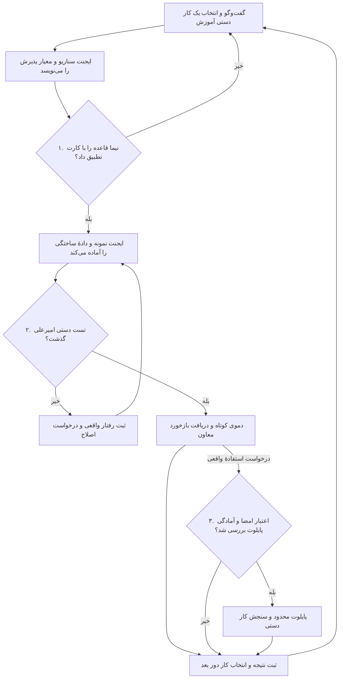

# فرایند تیم ۳۷؛ از نیاز تا نمایش

در هر دور یک مسیر کوتاه را پیش می‌بریم. معیار نخستین دمو این است که دانشجو بتواند استاد و موضوع را ثبت کند و تا پیش از امضای مدیر گروه، انتخاب را در وضعیت انتظار ببیند. نتیجهٔ دمو می‌تواند دامنهٔ دور بعد را عوض کند.

| فعالیت | انجام‌دهنده و خروجی | نقطهٔ تأیید انسانی و خطایی که می‌گیرد |
|---|---|---|
| ارتباط و برنامه‌ریزی | امیرعلی با معاون و کارشناس آموزش یک کار تکراری را مشخص می‌کند. نیما روایت استاد و دانشجو را می‌گیرد. | امیرعلی یک هدف قابل مشاهده برای همان دور انتخاب می‌کند تا تیم قابلیت بی‌ارتباط نسازد. |
| مدل‌سازی | ایجنت از توضیح نیما یک سناریو، دو وضعیت و مثال پذیرش می‌نویسد. | **۱. نیما، پیش از ساخت نمونه**، منبع هر قاعده را می‌سنجد. اگر امضای الکترونیکی یا تأیید استاد بی‌منبع الزامی شده باشد، آن را برای فاز دوم باز می‌گذارد و سناریو را برمی‌گرداند. |
| ساخت و اصلاح نمونه | ایجنت نمونهٔ نمایشی و دادهٔ ساختگی را از سناریوی پذیرفته‌شده می‌سازد. خطای مشاهده‌شده را با همان مثال اصلاح می‌کند. | نیما مطابقت نسخه با محدودهٔ تأییدشده را می‌سنجد. داده و شاهد امضای این نسخه صرفاً نمایشی‌اند. |
| تست دستی | امیرعلی در نقش دانشجو انتخاب را ثبت می‌کند، صفحه را دوباره باز می‌کند و انتظار و مشاهده را کنار هم می‌نویسد. | **۲. امیرعلی، پیش از نمایش**، وضعیت بدون امضا را می‌سنجد. در افزایش بعد، شاهد معتبر و نامعتبر را هم جدا می‌آزماید. شکست، نسخه را برای اصلاح و تکرار همان آزمون برمی‌گرداند. |
| نمایش و بازخورد | امیرعلی نمونه را بدون کدخوانی در این مرحله به معاون نشان می‌دهد. نیما برداشت معاون و یک تصمیم برای ادامه را یادداشت می‌کند. | معاون دربارهٔ درستی برداشت از نیاز بازخورد می‌دهد. امیرعلی پایان هر ماه دست‌کم یک پیشرفت قابل مشاهده ارائه می‌کند. |
| انتقال از نمایش به پایلوت | نیما مسیرهای تغییر وضعیت را فنی بازبینی می‌کند. امیرعلی سناریوهای پذیرش را تکرار می‌کند و با کارشناس آموزش شاخص پایه را می‌سنجد. | **۳. پیش از مصرف واقعی**، شیوهٔ معتبر امضا از مدیر گروه روشن شده، نهایی‌سازیِ بدون امضا رد شده و مسئول پایلوت نتیجه را پذیرفته باشد. این تأییدِ نسخه، جای امضای مدیر گروه پای هر انتخاب را نمی‌گیرد. |

## تعریف انجام‌شدن یک افزایش نمایشی

- [ ] یک رفتار، منبع قاعده و پرسش‌های بازِ مربوط به آن ثبت شده‌اند.
- [ ] نیما معیار همان افزایش را پیش از ساخت بررسی کرده است.
- [ ] امیرعلی مسیر اصلی و یک حالت ناموفق را با دادهٔ ساختگی دستی آزموده و برای هرکدام انتظار و نتیجه نوشته است.
- [ ] در مسیر ثبت، بازکردن دوبارهٔ انتخابِ بدون امضا همچنان وضعیت «در انتظار امضا» نشان می‌دهد.
- [ ] اگر اصلاحی انجام شده، همان مثال شکست‌خورده روی نسخهٔ اصلاح‌شده تکرار شده است.
- [ ] نسخهٔ نمایش‌داده‌شده و بازخورد مشتری ثبت شده‌اند. امیرعلی پذیرش افزایش نمایشی را تأیید کرده است. ایراد بازِ مؤثر بر معیار پذیرش، افزایش را به اصلاح برمی‌گرداند.

تیک‌ها هنگام اجرای واقعی توسط مسئول هر فعالیت پر می‌شوند. «انجام‌شدن» در این فهرست به یک افزایش نمایشی مربوط است. پایلوت، تأیید سوم را هم لازم دارد.
